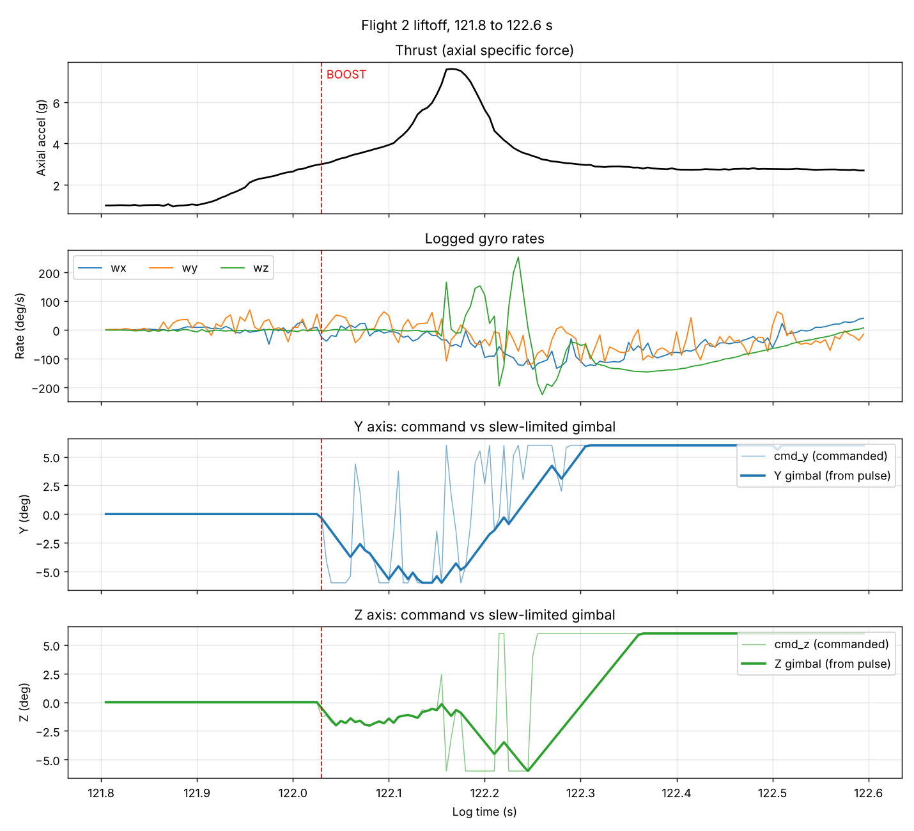
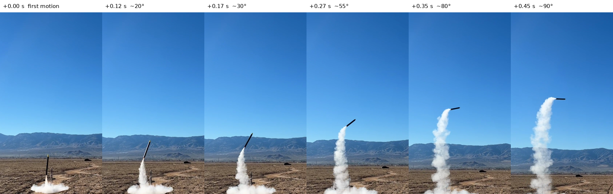
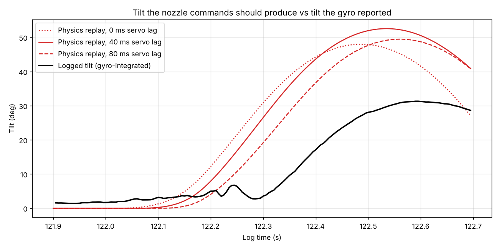

# Flight 2

**Date:** 2026-11-06
**Location:** Lucerne Valley Dry Lake Bed
**Motor:** Estes F15-0 (plugged — no ejection charge, recovery is servo-actuated)
**Vehicle mass:** ~701g
**Pad:** New tower, no rail. Arms hold the vehicle on a raised platform and retract before ignition; exhaust exits through a hole ~6" above the ground.
**Result:** Left the pad vertical, pitched to roughly horizontal within ~0.45 s, partially recovered, then pitched over again. Parachute deployed late and did not unfurl. Hard landing; upper airframe not reflyable, flight computer intact.

---

## Summary

Motor vibration corrupted the gyro, and the controller acted on the corrupted signal.

1. **Fake rate.** From the moment the motor lit, the gyro reported rotation that wasn't happening — `wy` averaged +23 °/s while the vehicle was still sitting on the pad.
2. **Full-deflection kick.** The D term turned that fake rate into nozzle command. Combined with a small pad-tilt P term, the Y gimbal was driven to −6° and held there through the motor's ~52 N initial thrust spike.
3. **Hidden rotation.** The gyro reported only a fraction of the rotation that kick produced, so the controller never pushed back until the vehicle was already far over.

The same signature — an immediate pitchover in video with a logged attitude far smaller — appears in Flight 1. **This supersedes the Flight 1 conclusion that a crooked rail was the root cause.** See [Revisiting Flight 1](#revisiting-flight-1).

The vibration mechanism inside the sensor is not yet proven. The tests under [Next steps](#next-steps) are designed to confirm or rule it out.

---

## Files

| File | What it is |
|---|---|
| `capture.log` | Raw PuTTY capture of the flash dump. The irreplaceable artifact. |
| `liftoff_analysis.py` | Reproduces every number and figure in this README from the decoder's CSV |
| `liftoff_detail.png` | Thrust, gyro rates, and commanded vs actual gimbal angle, 121.8–122.6 s |
| `liftoff_replay.png` | Gyro-free physics replay vs logged tilt |
| `liftoff_frames.png` | Video frames from first motion to horizontal |

The phone video (`IMG_2471.mov`, 36 MB) is kept outside the repo.

**This dump holds two sessions.** Flight 2 is the decoder's "Flight 1" (27,309 records); the decoder's "Flight 2" is a short pad-only session recorded afterwards.

Decode and reproduce:

    cd flight_2
    python ../TVC_Flight_Software/tools/decode_flight_log.py capture.log --flight 1 --no-trim --no-plots --csv flight2.csv
    python liftoff_analysis.py flight2.csv

---

## Software as flown

Control law, gains, and state machine unchanged from Flight 1. Servo trims and limits were re-measured after the TVC mount reprint.

| Constant | Value |
|---|---|
| `Kp_att` | 86.0 deg/rad |
| `Kd_att` | 10.0 deg per rad/s |
| `MAX_DEFLECT` | 6.0° |
| `SLEW_MAX_US` | 25 |
| `SERVO_MY_TRIM` / `SERVO_MY_USPD` / `SERVO_MY_SIGN` | 1600 µs / 44.4 µs/deg / −1.0 |
| `SERVO_MX_TRIM` / `SERVO_MX_USPD` / `SERVO_MX_SIGN` | 1875 µs / 48.5 µs/deg / +1.0 |
| `EJECT_BACKUP_PASSES` | 1500 (7.5 s after launch detection) |
| Gyro | ISM330DHCX, `CTRL2_G` = 0x58 (208 Hz, ±1000 dps), 35 mdps/LSB |

Design targets behind the gains: ω_n = 12 rad/s, ζ = 0.7, at 15 N average thrust. See `../TVC_Flight_Software/TUNING.md`.

---

## What the log shows

**State timeline** (log time; the vehicle sat armed on the pad for ~122 s):

| Time | State |
|---|---|
| 0.00 s | PAD |
| 122.03 s | BOOST |
| 123.99 s | COAST — early, motor still burning (see below) |
| 126.56 s | DESCENT — ejection fired on apogee detection |

| Metric | Value |
|---|---|
| Actual burn (axial accel) | 121.91 → 124.62 s, 2.71 s |
| Detected burn (BOOST state) | 1.96 s |
| Peak axial accel | 7.6 g at 122.16 s (~52 N, the F15's initial spike) |
| ∫ axial accel over burn | 6.8 g·s → ~47 N·s, consistent with the F15's total impulse |
| Max altitude / vertical velocity | 60.9 m / 30.5 m/s — filter estimates, not trustworthy this flight |
| Max logged tilt | 141.9° — logged attitude under-reports, see below |
| Large shock | ~130.0 s, accelerometer clipped — most likely ground impact |
| Loop rate | 200 Hz, dt 5.00 ms, no overruns |

The impulse check matters: it confirms the log time base and accelerometer scale are correct, so the problems below are not timing or units errors.

| Flag | Of log | Of burn |
|---|---|---|
| SAT_Y | 1.2% | 81.4% |
| SAT_Z | 1.2% | 82.9% |
| NO_TRUST | 4.5% | 100% (expected) |
| OVERRUN | 0 | 0 |
| PULSE_Y / PULSE_Z | 0 | 0 |
| EJECT_BAK | 0 | 0 |

---

## Liftoff, tick by tick

| Time | Event |
|---|---|
| 121.86 s | Motor lights. Vehicle still on the pad (axial ≈ 1.0 g), servos at trim, controller inactive. Gyro noise jumps from ±0.5 °/s to tens of °/s; `wy` averages **+23 °/s**. |
| 121.91 s | Thrust exceeds weight — liftoff. |
| 121.925 s | NO_TRUST sets (accel > 1.3 g). Expected: launch detection is still counting its 100 ms debounce. |
| 122.03 s | BOOST. Servos leave trim. Logged tilt is still ~2°: **no rotation before control started.** |
| 122.03–122.15 s | `cmd_y` flips several times on gyro noise but is mostly −6°. The slew limiter averages it, so the Y gimbal ramps to −6° by 122.13 s and holds. |
| 122.16 s | Thrust spike peaks (7.6 g, ~52 N) with the Y gimbal at −6°. |
| 122.16–122.27 s | `wz` spikes of ±200 °/s flip `cmd_z`; the Z gimbal ramps to −6°. |
| ~122.23 s | Y gimbal crosses back through trim; both axes reach +6° by ~122.36 s. |

Video, from first visible motion: ~20° at +0.12 s, ~55° at +0.27 s, ~80° at +0.35 s, horizontal by ~+0.45 s. Visible motion starts around 122.0 s in log time (±0.1 s), so when the video shows ~80° the logged tilt is still under 10°.

---

## What went wrong

### 1. Motor vibration corrupted the gyro

| Phase | Mean rate x / y / z (°/s) | High-frequency content x / y / z (°/s) |
|---|---|---|
| Pad, still | 0 / 0 / 0 | 0.1 / 0.3 / 0.2 |
| Ignition, still on pad | 4.6 / **23.5** / −2.0 | 3.4 / 10.3 / 2.9 |
| Boost, first 0.3 s | −43.8 / −11.2 / −5.0 | 19.7 / 34.7 / 76.0 |
| Coast, no thrust | — (tumbling) | 5.7 / 6.3 / 8.6 |

High-frequency content is what remains after removing a 50 ms moving average. It rises by one to two orders of magnitude under thrust and falls back once the motor burns out.

- **The offset appears with the vehicle stationary and the servos at trim**, so the source is the motor, not the controller or servo current.
- **Much of the logged rate is not rigid-body motion.** The largest tick-to-tick change during boost is 243 °/s in 5 ms (~49,000 °/s²). Full gimbal deflection at peak thrust produces about 2,000 °/s².
- **Avionics mounting is a plausible amplifier.** The Perma-Proto board is the only structure spanning the avionics bay (the two ring mounts are not connected), and the IMU breakout sits near mid-span on header pins. A thin board held only at its ends likely has bending and twisting modes in the motor's vibration band.

### 2. The fake rate drove a full-deflection kick at peak thrust

At BOOST, `cmd_y = Kp·err_y − Kd·wy`:

- P term from the ~1.6° pad tilt on Y: about −2.3°
- D term from the vibration offset: `Kd_att` = 10 means every 5.7 °/s of rate commands 1° of nozzle, so +23 °/s alone asks for about −4°
- Sum: about −6.3°, clamped to −6°

The slew limiter (25 µs/tick ≈ 0.56°/tick on Y) moves the pulse toward wherever the command currently is, so the gimbal follows the *average* of a noisy command. Zero-mean noise would mostly cancel. A one-sided offset does not — it became a sustained −6° push, landing on the thrust spike: 52 N × 0.429 m × sin 6° ≈ 2.3 N·m, about 35 rad/s².

At that spike the same gains are also far stiffer than designed — effectively ω_n ≈ 22 rad/s against the 19 rad/s actuator ceiling, since they were sized for 15 N.

### 3. The gyro missed the rotation it caused

The physics replay integrates rigid-body pitch and yaw from the logged gimbal angle and measured thrust, with **no gyro input**. With 40 ms of servo lag it reaches ~200 °/s and ~35° by 122.35 s, while the gyro reported under 10°. It peaks near 53°; the logged tilt peaks near 31°; the video shows ~90°. The replay ignores roll and aerodynamics, so it is a lower bound on the real motion.

**What is established:**
- Re-integrating the logged rates offline reproduces the logged quaternion to within 0.03°. The firmware integrated exactly what the gyro reported.
- The gyro configuration and scale are correct (`CTRL2_G` = 0x58, 35 mdps/LSB).
- The gyro output itself contains only a fraction of the rotation the video and the physics replay show.

**Leading hypothesis, not yet proven:** vibration large enough to clip somewhere inside the sensor *before* its internal low-pass filter. A slow real rotation only registers during the unclipped part of each vibration cycle, so after filtering it is scaled down by roughly (2/π)·arcsin(range / vibration amplitude) — about 1/3 when vibration is twice the internal range. The logged ±200 °/s spikes are what survives that filter; the clipping itself happens where the 200 Hz log cannot see it. This fits a consistent under-read in both flights, worst at the thrust spike.

### 4. Downstream consequences

- **Early COAST.** Burnout detection uses world-frame vertical acceleration. Flying sideways under thrust, that reads about −g, so COAST triggered at 123.99 s with the motor burning until 124.62 s. TVC shut off with ~0.6 s of thrust left.
- **Late apogee.** The filter's altitude peaked at 125.10 s while its vertical velocity still read +20.4 m/s. The accelerometer was being rotated into the world frame with an attitude that was far too upright. DESCENT fired at 126.56 s, ~1.5 s after the altitude peak, leaving the chute too little time to unfurl.
- **Filter altitude and velocity** for this flight are unreliable for the same reason.

### 5. Roll

Logged `wx` reached about −375 °/s during boost, and the true value is likely higher. With ~50–100 ms between computing a correction and the nozzle arriving, a fast-rolling body turns corrections away from the frame they were computed in. This probably contributes to the later back-and-forth. It does not explain the initial departure, which happens within 0.2 s.

---

## Ruled out

| Suspect | How |
|---|---|
| Firmware attitude integration | Offline re-integration matches the logged quaternion to 0.03° |
| Gyro configuration | `CTRL2_G` = 0x58, sensitivity 35 mdps/LSB, both correct for ±1000 dps |
| Actuator signs and axis mapping | Lateral accelerometer tracks gimbal angle in flight: corr(az, Y) = +0.98, corr(ay, Z) = −0.93, the signs correct torque requires |
| D-term sign | d(`err_y`)/dt = −`wy`, d(`err_z`)/dt = −`wz`, so `Kp·err − Kd·ω` is a consistent PD law |
| Launch-detection latency | Logged tilt is still ~2° at BOOST; the departure follows the gimbal kick |
| Pad interaction | No rail; arms retract before ignition; departure follows the gimbal kick, not liftoff |
| Log time base / accel scale | Burn impulse ≈ F15 total impulse; burn duration matches the video |

---

## Revisiting Flight 1

Flight 1 shows the same signature: an immediate pitchover in video while the logged attitude stays around 20–30°. The crooked rail was at most a contributor.

The Flight 1 "~10° initial tilt" came from the PAD records immediately before BOOST. In Flight 2 those final ticks are already under thrust, with accel trust off and the gyro vibrating, so the same reading in Flight 1 may be contaminated. **Check `flight_1/capture.log`:** if that error was present throughout the pad hold, the rail was crooked; if it appeared only in the last ~0.1 s before BOOST, it was this mechanism.

The Flight 1 observation that "TVC visibly recovered the vehicle" should be read in the same light.

---

## What worked

- **Logging: flawless again.** 27,309 records at 5.00 ms, zero overruns, full decode on the first attempt.
- **Ejection fired on apogee detection**, not the backup timer. It was late because of the estimator, but the servo latch released and the chute came out.
- **The actuator chain is correct.** The nozzle went where it was commanded, with the right sign, confirmed by the accelerometer in flight.
- **The new pad** released cleanly with no rail interaction.
- **The flight computer survived** a hard landing.

---

## Next steps

**Not flying again until the gyro reads clean under motor vibration.** Gains are meaningless until then.

### Tests

**Before any bench test:** disconnect the ejection servo or unload the latch. The vehicle arms after 20 s of stillness, and vibration can fake a launch detection, which enables TVC and starts the 7.5 s ejection backup timer.

Run all tests with `DRIFT_TEST 1`, so attitude is pure gyro integration as in boost.

1. **Baseline rotation, no vibration.** Rotate exactly 90° against a square edge about Y, Z, and X, then a compound move (roll 90°, then pitch 90°). Each should read ~90°.
2. **Fake-rate test.** Clamp the vehicle still and press a vibration source against the airframe near the motor mount (an oscillating multi-tool is strongest). A tens-of-°/s offset reproduces the pad signature.
3. **Compression test.** Repeat test 1 with vibration running. A reading well short of 90° confirms the mechanism.
4. **Headroom A/B.** Change only `CTRL2_G` to 0x5C and the sensitivity to 70 mdps/LSB (±2000 dps), then repeat test 3. If the reading recovers, clipping is confirmed.
5. **Restrained static fire**, if a site can be found. The gold standard, since no bench tool reproduces the motor's vibration. Vehicle unable to move, servos at trim; any gyro reading is error. If bench tests show nothing, the result is inconclusive, not an all-clear.

### Fixes, one at a time, re-running tests 2–3 after each

1. **Mount.** Add rails tying the two rings together so the board is not the structure. Hard-mount the IMU breakout flat with screws and standoffs near a ring, not on headers mid-span.
2. **D-term filter.** Low-pass the rate feeding the D term, with the cutoff well above the 12 rad/s (~2 Hz) loop bandwidth.
3. **Gyro configuration.** Keep ±2000 dps if test 4 justified it; check the gyro's internal filter bandwidth settings.
4. **Alignment offset.** After re-mounting, stand the vehicle plumb, read the logged tilt, and subtract it as a fixed mounting offset.

### After the gyro reads clean

- **Burnout detection:** use body-axis acceleration along the thrust line instead of world-frame vertical acceleration.
- **Apogee detection:** re-evaluate once attitude is fixed; consider a baro-based backup.
- **Logging:** add raw baro altitude to `LogRecord` (82 bytes, still 3 per page).
- **Decoder:** stale trim lines; flights titled by position in the dump.
- **Gains:** thrust-scheduled gains for the initial spike.
- **Roll.**
- **Rebuild the upper airframe.**
